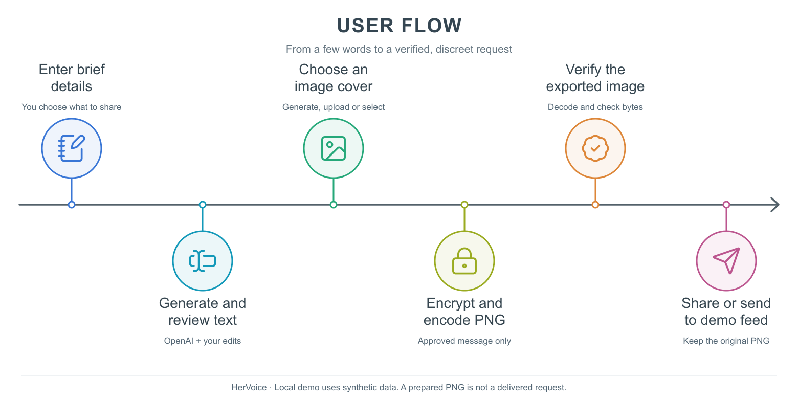
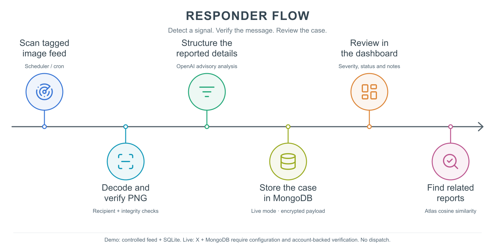
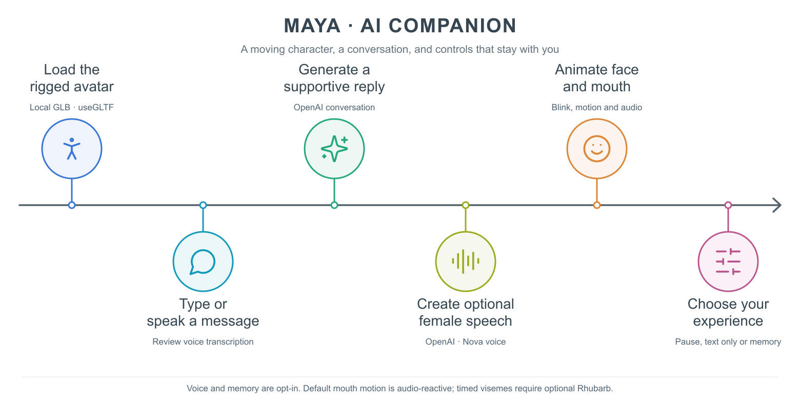
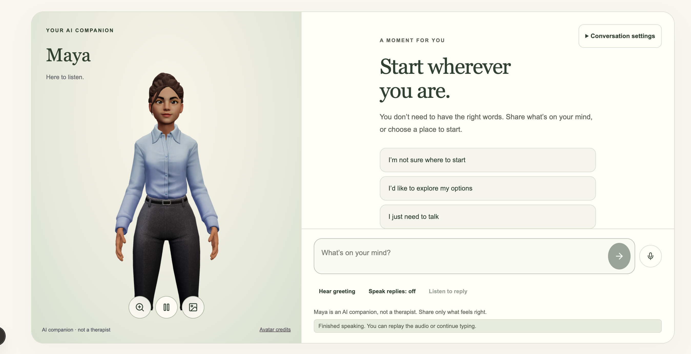
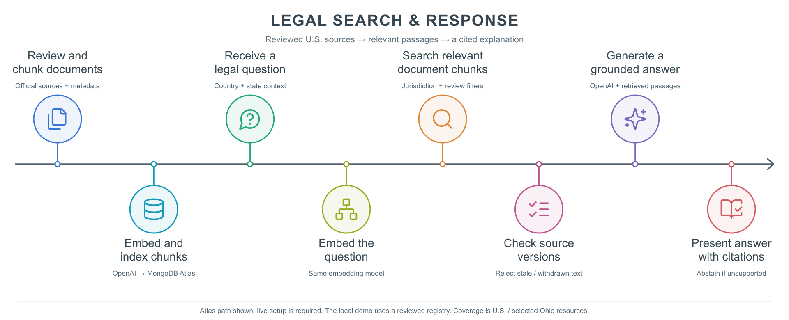
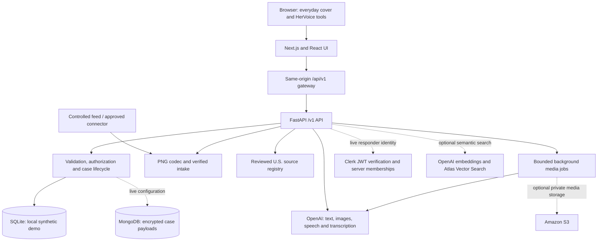

# HerVoice

### A quiet way to reach out. A stronger voice for what comes next.

A U.S.-first support platform combining discreet image-based requests, an animated AI companion, source-backed legal information, and a responder workspace.

[Try locally](#how-to-set-it-up-locally) · [Architecture](#system-architecture) · [API setup](docs/api-setup.md)

> **Hackathon prototype:** use synthetic information. HerVoice demonstrates the complete request-to-responder workflow; it does not contact real authorities or provide emergency dispatch. A neutral website and hidden image payload cannot guarantee secrecy on a monitored device.

## Inspiration 🌟

Asking for help can be difficult when someone else watches your phone, messages, or online activity. Even finding the words to describe a situation can feel overwhelming.

HerVoice explores how a familiar, everyday website can offer a low-pressure entry into support. A person can write a few details, review their own message, prepare an ordinary-looking image, talk with an AI companion, or find information about their rights. The experience emphasizes clear choices, visible controls, and permission before voice, location, or saved conversation memory is used.

## What It Does 💡

### The problem

People experiencing abuse may face limited privacy, uncertainty about their options, and difficulty accessing support. A useful interface needs to be easy to understand under stress and honest about what happens after a request is submitted.

### HerVoice’s solution 💪

| Experience | What we built |
| --- | --- |
| **Discreet entry** | Rotating **Everyday Notes**, **Everyday Music**, and **Everyday Books** covers, each with the same highlighted clue and **Open personal space** button. |
| **Create a post** | A four-step flow: enter details, review text and generate images, submit/share, and view an accurate completion state. |
| **Maya, the AI companion** | Text conversation, optional voice input and female AI speech, plus a moving 3D character with facial animation. |
| **Law bot** | Retrieval from reviewed U.S. source summaries, optional OpenAI synthesis, and links to the underlying resources. |
| **Responder dashboard** | A live-updating case table, detailed case cards, location/map controls, related-report search, and recorded case activity. |

The main navigation is **Home · Create a post · Law bot · Therapy bot · Dashboard**. “Therapy bot” opens an AI support companion, not a licensed therapist.

## Detailed Description 📝

### 1. Discreet requests through steganography

HerVoice turns an approved support message into an encrypted payload inside an ordinary PNG. Image generation and message encoding are separate steps: OpenAI receives the cover-image prompt, while our backend encrypts and embeds the approved message.

#### How it works 🛠️

**User side**



1. **Describe the situation.** Enter a short description and optional alias, safe contact preference, location, duration, incident frequency, and other details. Location can be typed or requested through the browser with consent.
2. **Review the message.** OpenAI can expand brief notes into a readable draft. The user can edit every word or continue manually.
3. **Choose an image.** Generate three covers from a prompt, select a built-in cover, or upload a PNG.
4. **Encode and verify.** The backend encrypts the exact approved narrative, embeds it into PNG pixels, and decodes the exported bytes to verify the result.
5. **Choose a delivery path.** Download/share the original file, submit directly to the demo queue, or send to the controlled tagged demo feed. A downloaded image is marked **Prepared**, not delivered.

**Responder side**



1. **Receive a signal.** Upload an original PNG for verification, or let the controlled `#HerVoiceSignal` feed scanner process it. The scanner runs every 30 seconds and also supports **Scan now**.
2. **Decode and verify.** The API checks the image framing, encrypted payload, recipient organization, and request linkage before recording receipt. Repeated intake does not create duplicate cases.
3. **Review structured information.** Optional OpenAI analysis produces an advisory summary, reported issue categories, review flags, and a severity suggestion.
4. **Manage the case.** Responders review severity and priority, assign cases, record notes, and close an issue with a reason. Updates create actual activity events; stale edits are rejected.

#### What sets it apart 🌠

- **User-approved content:** original input and the approved narrative remain separate.
- **Verified delivery states:** preparing a file, queueing a signal, and receiving a case are different events.
- **Organization-scoped access:** one organization cannot decode or browse another organization’s cases.
- **Human review:** AI suggestions do not silently change case priority or establish anyone’s identity.

#### Technical details

The codec uses least-significant-bit pixel encoding with an `HV01` frame, payload length, SHA-256 digest, nonce, and AES-GCM ciphertext. It checks capacity, preserves UTF-8 content, and rejects damaged or unauthorized payloads.

The encryption is server-readable, not end-to-end. Resizing, screenshots, JPEG conversion, and social-platform recompression can destroy the payload. A read-only X hashtag connector is implemented and requires account-backed verification. Public publishing and Instagram/Telegram/Slack monitoring are not connected; the demo feed preserves original PNG bytes to demonstrate the full flow. See [authority and Atlas setup](docs/authority-atlas.md).

### 2. Maya: an animated AI support companion 💬

Maya provides a welcoming place to type, pause, or ask for a small grounding exercise. The support instructions emphasize autonomy, no blame, and no pressure to disclose or confront someone.

#### How it works



- **Text conversation:** OpenAI receives the current conversation context and generates a supportive response.
- **Voice input:** choosing **Speak your message** records audio for transcription. The transcript is editable before sending.
- **Female AI voice:** **Listen to reply** uses OpenAI speech with the `nova` voice. Automatic spoken replies are off by default.
- **Moving avatar:** a locally bundled, rigged Ready Player Me character blinks, moves gently, and animates its mouth during audio playback.
- **Optional memory:** explicitly enabled conversation memory is encrypted, limited to 20 messages, and expires after 24 hours. Users can turn it off and delete it.

#### What sets it apart ✨

The studio keeps the character central, with a peach/lavender background, a floating message dock, and an optional transcript. Users can zoom, pause animation, switch to a still image, or use text only. Reduced-motion preferences and WebGL fallback are supported. Speech is labelled AI-generated, and no camera or facial-recognition feature is used.

#### Technical details 🛠️

React Three Fiber, drei’s `useGLTF`, and Three.js render the GLB model. Bone motion and facial morph targets handle idle movement, blinking, and subtle expression cues. A browser audio analyser drives approximate mouth movement; optional Rhubarb cues provide timed visemes. Default animation does not claim phoneme-perfect lip sync.

Maya is a prompted support experience, not a clinically trained or validated treatment. Its character asset has separate non-commercial demo terms and attribution: [companion details](docs/companion.md) · [asset notice](apps/web/public/models/maya-reference.LICENSE.txt).



### 3. Law bot for understanding options ⚖️

The Law bot helps users explore U.S. support resources and legal-information starting points in plain language. Its current source set includes national guidance and selected Ohio protection-order resources.

#### How it works 🤖



The diagram shows the optional Atlas retrieval path. The default local flow is:

1. Receive the question and selected jurisdiction/state.
2. Retrieve relevant reviewed summaries using jurisdiction, source status, review expiry, lexical relevance, and local hash-vector ranking.
3. When OpenAI is enabled, synthesize a response using the retrieved material.
4. Present the answer with source links and coverage limitations. Unsupported questions or jurisdictions abstain.

#### What sets it apart 💡

Sources come from the maintained registry rather than invented model URLs. Ohio-specific information is eligible only when Ohio is selected. The bot offers general information and resource navigation, not personalized legal advice or a complete legal database.

The no-key legal retriever uses the local reviewed registry. `LEGAL_PROVIDER=atlas` enables OpenAI query embeddings and MongoDB Atlas Vector Search over explicitly indexed legal chunks, followed by the same source-backed response generation. PDF chunking, ingestion, and index setup are included; live Atlas verification is pending. LangChain is not required.

### 4. Responder dashboard and related-report matching

The dashboard polls for case changes every five seconds. Responders can filter the table, sort severity, choose columns, and open a case for its contact preference, incident details, reported location, status, and activity timeline.

Google Maps loads after selecting **Load Google map**; the reported location is then sent to Google. A separate Maps link is available. The default web embed needs no key, and an optional restricted Maps Embed API key is supported.

#### Find Match

**Find Match** retrieves similar reports for a responder to review. It does not identify a perpetrator or report an identity probability.

- **No-key mode:** lexical related-report search.
- **OpenAI demo mode:** 768-dimensional embeddings and cosine ranking over authorized synthetic reports, with a bounded process-local cache.
- **Optional Atlas mode:** MongoDB Atlas `$vectorSearch` with organization/model filters and a configured vector index.

Results exclude the current case and unrelated organizations. Responders can adjust the result count and threshold and save review decisions.

## How We Built It 🔧

### System architecture

The illustrated flows above are maintained as [editable SVG and PNG assets](docs/diagrams). Regenerate them with `node scripts/render_readme_diagrams.mjs` after installing the project dependencies.



| Layer | Technologies and responsibility |
| --- | --- |
| Frontend | Next.js 16, React 19, strict TypeScript, custom CSS, Lucide icons, accessible responsive controls. |
| Avatar | Three.js, React Three Fiber, drei, local GLB model, facial morph targets, browser audio analysis. |
| Backend | Python 3.13, FastAPI, Pydantic validation, authorization, request receipts, case events, provider adapters. |
| AI | OpenAI Responses, image generation, text-to-speech, transcription, and optional embeddings. |
| Image transport | Pillow PNG processing, LSB encoding, AES-GCM encryption, integrity and recipient checks. |
| Data | SQLite for synthetic local use; MongoDB adapter for live configuration. |
| Authentication | Private guest receipt cookies; synthetic demo sessions; verified Clerk identity plus server-managed memberships in live mode. |
| Jobs | Bounded in-process executor with durable job metadata, progress, cancellation, expiry, and scoped media access. |
| Verification | Pytest, Ruff, TypeScript, production build, generated OpenAPI contracts, Playwright desktop/mobile journeys, and accessibility checks. |

FastAPI owns permissions and case rules, including direct API calls. The Next.js gateway forwards requests; it does not independently decide responder access. The current job executor is not a separately deployed durable queue worker.

### Important API routes

Routes below are served by FastAPI. Browser requests use the same-origin `/api/v1` gateway.

| Route | Purpose |
| --- | --- |
| `POST /v1/drafts` | Expand supplied details into an editable draft. |
| `POST /v1/requests` | Create a request with private receipt access. |
| `POST /v1/requests/{id}/covers` | Start cover-image preparation/generation. |
| `POST /v1/requests/{id}/jobs/{job}/encode/{index}` | Encode the selected generated cover. |
| `POST /v1/requests/{id}/image` | Encode a supplied PNG. |
| `POST /v1/requests/{id}/demo-signal` | Queue an original PNG in the controlled demo feed. |
| `POST /v1/intake/preview` and `/v1/intake/confirm` | Verify an image, then confirm intake. |
| `POST /v1/monitor/scan` | Scan eligible feed items. |
| `GET /v1/cases` and `PATCH /v1/cases/{id}` | Read the scoped queue and update a case. |
| `POST /v1/cases/{id}/analysis` and `/v1/cases/{id}/related` | Advisory analysis and related-report search. |
| `POST /v1/support`, `/v1/support/transcribe`, `/v1/support/media` | Support conversation, voice input, and generated speech. |
| `GET`, `PUT`, `DELETE /v1/support/memory` | Consent-based conversation memory. |
| `POST /v1/legal` and `/v1/encouragement` | Source-backed legal information and encouraging text. |

The complete interactive contract is available at [localhost:8000/docs](http://localhost:8000/docs).

## How AI Is Used Throughout the Project 🤖

| Feature | AI’s role | User or responder control |
| --- | --- | --- |
| Message expansion | Turn brief notes into coherent text without requesting invented facts. | Review and edit before submission. |
| Image generation | Create ordinary cover images from a separate image prompt. | Choose the image; encoding happens afterward. |
| Intake analysis | Suggest structure, review flags, and severity. | Responders retain severity and priority decisions. |
| Related reports | Embed descriptions for semantic comparison. | Review leads; no identity claim. |
| Maya | Generate supportive conversation and presentation cues. | Text-only, voice, animation, and memory choices. |
| Speech | Transcribe recordings and speak replies. | Deliberate recording, editable transcript, stop/replay controls. |
| Law bot | Explain retrieved U.S. source summaries. | Inspect citations and jurisdiction limits. |
| Encouragement | Generate short supportive text. | Optional; no promise that help is on the way. |

## Where MongoDB and Atlas Fit 🗄️

The local demo uses SQLite so coworkers can run it without a database account. With live configuration, MongoDB stores cases, memberships, intake records, jobs, review decisions, and consented memory. Sensitive case payloads are encrypted with AES-GCM; operational metadata remains searchable.

Atlas Vector Search is an optional adapter for related reports, with 768-dimensional embeddings and organization/model filtering. It requires a configured cluster, vector index, and indexed authorized records. It has not been smoke-tested against a live Atlas account. See [architecture](docs/architecture.md) and [API setup](docs/api-setup.md) for deployment requirements and limits.

## How to Set It Up Locally

### Prerequisites

- Node.js 22 and Python 3.13.
- Git and a terminal.
- An OpenAI API key only if you want generated text, images, AI speech, transcription, or semantic embeddings.

### Quick start

```bash
git clone https://github.com/Preetham-p06/HerWay.git
cd HerWay
cp .env.example .env
./scripts/dev.sh
```

The script installs missing dependencies and starts both services. Open [http://localhost:3000](http://localhost:3000). Stop with Ctrl+C. The no-key demo needs no MongoDB, Clerk, AWS, or avatar-service account.

### Enable OpenAI features

Keep these settings in the root `.env`, alongside the existing demo configuration. The values below are the models configured by this project; access depends on your API project.

```dotenv
APP_MODE=demo
NEXT_PUBLIC_APP_MODE=demo
TEXT_PROVIDER=openai
IMAGE_PROVIDER=openai
SPEECH_PROVIDER=openai
OPENAI_API_KEY=your_server_only_key
OPENAI_TEXT_MODEL=gpt-4.1-mini
OPENAI_IMAGE_MODEL=gpt-image-1.5
OPENAI_TTS_MODEL=gpt-4o-mini-tts
OPENAI_TTS_VOICE=nova
OPENAI_TRANSCRIBE_MODEL=gpt-4o-mini-transcribe

# Optional semantic matching over synthetic local reports:
EMBEDDING_PROVIDER=openai
OPENAI_EMBEDDING_MODEL=text-embedding-3-small
MATCH_PROVIDER=openai_local
```

Restart the development services after changing configuration. Keys stay server-side and must not be committed or placed in `NEXT_PUBLIC_*` variables. Provider errors are shown rather than presented as successful generation. Legacy Gemini, Bedrock, and ElevenLabs adapters remain in the codebase but are not used when the OpenAI selectors are enabled.

### Run the services separately

```bash
python3 -m venv .venv
.venv/bin/pip install -r services/api/requirements.lock
npm ci

# Terminal 1
.venv/bin/uvicorn services.api.main:app --env-file .env --reload --host 127.0.0.1 --port 8000

# Terminal 2
npm run dev
```

For standalone frontend startup, supply web variables through its environment or `apps/web/.env.local`. The combined script loads the root `.env` for both processes.

A container configuration is also provided:

```bash
docker compose up --build
```

Native startup has been exercised; the Compose setup is supplied but has not been validated in this development environment. No public deployment is claimed. Do not expose synthetic demo authentication to the internet. Live mode requires MongoDB, Clerk, independent encryption keys, organization memberships, and explicit origins; see [deployment requirements](docs/architecture.md).

## Impact and Current Boundaries

HerVoice demonstrates how a few plain-language details can become a verified support request and a structured responder workflow. It brings writing assistance, a companion, and legal-resource navigation into one interface without requiring the user to complete every feature.

We have not measured clinical outcomes, response-time improvements, or real-world safety effectiveness. The prototype does not guarantee privacy, continuous availability, or a response from an authority. Quick exit covers the interface and clears unsaved page state; it does not erase browser history, network activity, downloaded files, or device monitoring. Live X image delivery still needs account-backed validation; Instagram, real dispatch, and operational deployment remain outside the current demonstration.

## Verification ✅

```bash
npm run typecheck
npm run lint
npm test
npm run contracts
npm run build
npx playwright install chromium
npm run test:e2e
```

CI checks types, lint, backend behavior, generated-contract drift, the production build, and desktop/mobile browser journeys. The current suite has **48 backend tests and 36 browser tests**, including organization boundaries, PNG verification, case updates, and companion controls. Live external integrations have separate verification limits documented below.

## Repository and Documentation

| Path | Contents |
| --- | --- |
| `apps/web` | Frontend, same-origin gateway, avatar, and static assets. |
| `services/api` | API, storage, authorization, codec, AI adapters, retrieval, and jobs. |
| `services/worker` | Portable worker contract and operational notes. |
| `packages/api-client` | Generated OpenAPI snapshot and TypeScript input models. |
| `fixtures` | Reviewed source registry and synthetic fixtures. |
| `tests` | Backend tests and browser journeys. |

- [MongoDB authority workflow, X monitoring, and Atlas legal retrieval](docs/authority-atlas.md)
- [Architecture and deployment limits](docs/architecture.md)
- [API credentials and provider setup](docs/api-setup.md)
- [Companion, voice, memory, and asset attribution](docs/companion.md)
- [Hackathon demonstration](docs/hackathon-demo.md)
- [Feature parity](docs/feature-parity.md) and [workflow audit](docs/screenshot-parity-audit.md)
- [Verification](docs/verification.md) and [design system](docs/design-system.md)

The product is **HerVoice**; the shared GitHub repository retains its original name, **HerWay**.
